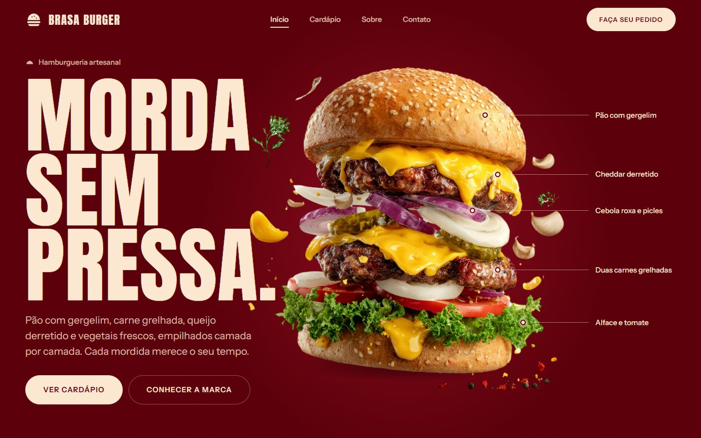
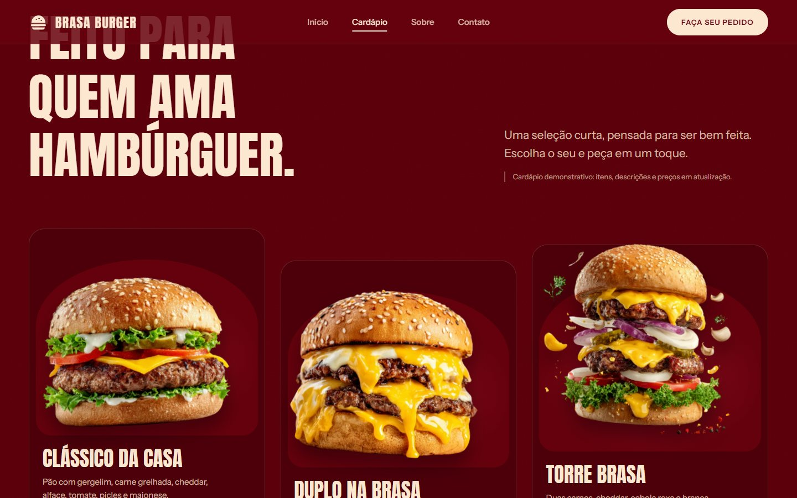
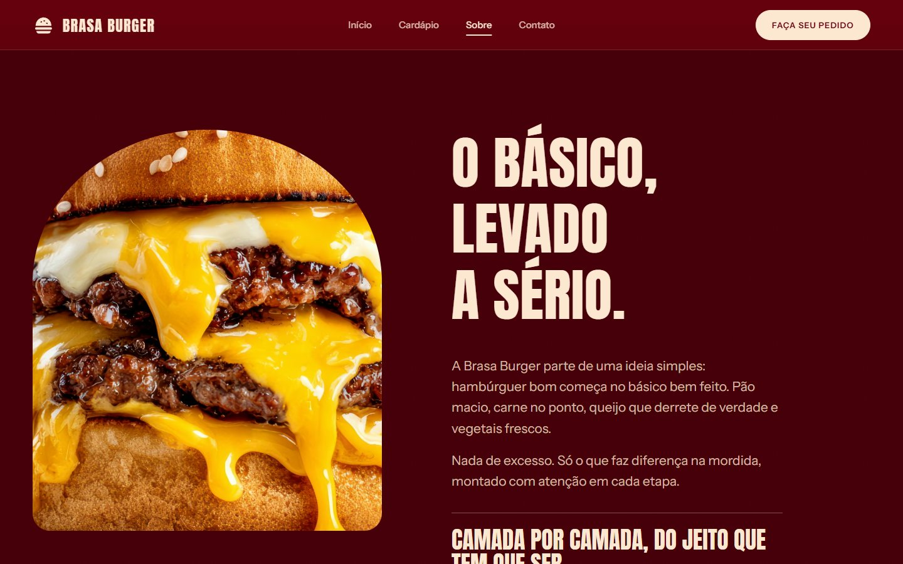
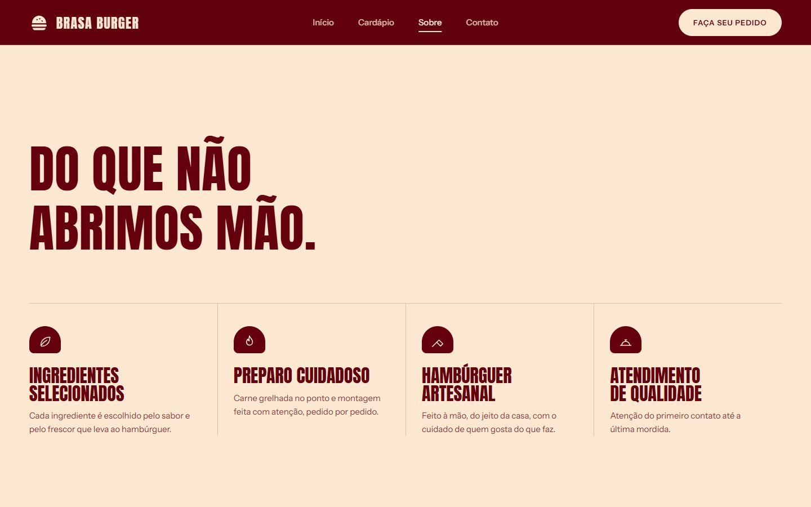
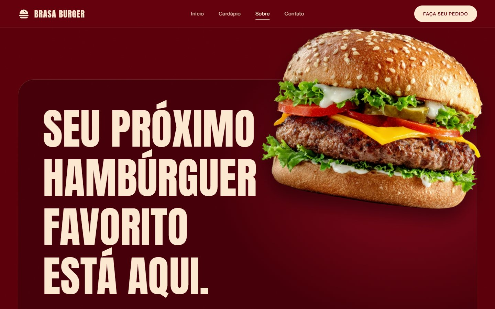
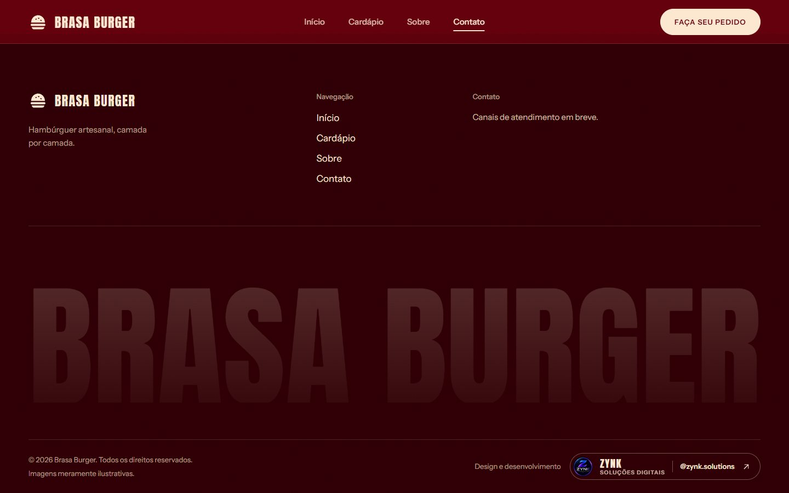
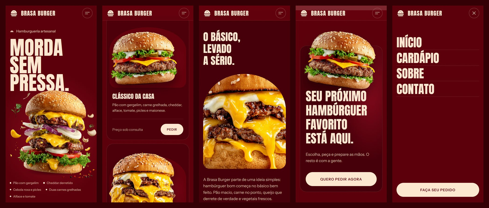

<div align="center">

# BRASA BURGER

**Landing page de hamburgueria artesanal com direção de arte editorial, produto como protagonista e engenharia de nível de produção.**

[**Ver ao vivo →**](https://brasa-burger.pages.dev)




<sub>Projeto idealizado, desenhado e desenvolvido pela <a href="https://www.instagram.com/zynk.solutions/"><b>ZYNK Soluções Digitais</b></a></sub>

</div>

---

## Sobre o projeto

**Brasa Burger** é uma marca fictícia criada para portfólio. O objetivo foi entregar uma landing page com acabamento de agência especializada em marcas gastronômicas: identidade autoral em duas cores, tipografia monumental e o hambúrguer como único elemento em cores plenas da página.

O projeto cobre o ciclo inteiro de um produto real: direção de arte, tratamento das imagens (com um pipeline próprio de recorte), desenvolvimento, acessibilidade, performance, SEO e deploy.

> Nenhum dado comercial foi inventado. Preços, contatos, endereço e horários são configuráveis e, quando vazios, a interface mostra estados honestos ("Preço sob consulta", "Canais de atendimento em breve"). Fotos de banco, meramente ilustrativas.

---

## Destaques para quem avalia

| | |
| --- | --- |
| **Recorte de imagem próprio** | As fotos vieram como JPG com o "xadrez de transparência" desenhado na imagem. Um script em Python reconstrói a grade e o degradê do fundo, recorta contra o fundo conhecido e desmistura as bordas: PNG com alpha real, sem halo, preservando salsinha, alho e grãos de pimenta. |
| **Hero editorial** | Título de 3 linhas sobreposto pelo produto, com legendas que apontam as camadas reais da foto (posições em % da imagem, então escalam com o layout). Sequência de entrada orquestrada e parallax por scroll. |
| **Animações sem JavaScript** | Revelações e parallax com `animation-timeline` (scroll-driven), com fallback estático e tudo desligado em `prefers-reduced-motion`. |
| **Tipografia que respeita o português** | A entrelinha dos títulos foi medida para que Ã, Ú e Á não colidam com a linha de cima. No título da Hero, só as linhas com acento ganham espaço extra, automaticamente. |
| **Acessibilidade real** | Menu mobile como diálogo com foco preso, Esc, `inert` no fundo e retorno de foco; skip link; seção ativa com `aria-current`; um único `h1`; `alt` em todas as imagens; foco visível. |
| **Performance mensurável** | CLS 0, LCP de 2,1 s em mobile com CPU 4× mais lenta e 4G lento. AVIF/WebP responsivos com `srcset`, preload da imagem principal gerado a partir da config, fontes auto-hospedadas. |
| **Uma fonte de configuração** | Marca, contatos, cardápio, textos e fotos ficam em `src/config`. Um plugin do Vite injeta título, Open Graph, canonical, preload e JSON-LD no `index.html` a partir dela. |
| **Zero dependências de UI** | Só React e React DOM em produção. Nada de bibliotecas de componentes, animação ou CSS utilitário. |

---

## Galeria

### Desktop

<table>
  <tr>
    <td width="50%"></td>
    <td width="50%"></td>
  </tr>
  <tr>
    <td align="center"><sub><b>Cardápio</b>: cards escalonados, foto que sai da moldura e pedido com mensagem pronta</sub></td>
    <td align="center"><sub><b>Sobre</b>: close em alta resolução na silhueta do pão, motivo da identidade</sub></td>
  </tr>
  <tr>
    <td></td>
    <td></td>
  </tr>
  <tr>
    <td align="center"><sub><b>Diferenciais</b>: seção invertida em creme para ritmo e contraste</sub></td>
    <td align="center"><sub><b>Chamada para pedido</b>: o produto rompe a borda do painel</sub></td>
  </tr>
  <tr>
    <td colspan="2"></td>
  </tr>
  <tr>
    <td colspan="2" align="center"><sub><b>Rodapé</b>: assinatura ajustada à largura exata do conteúdo para qualquer nome de marca (<code>useFitText</code>)</sub></td>
  </tr>
</table>

### Mobile



<sub>Não é o desktop encolhido: no mobile o hambúrguer se encaixa entre o título e a descrição, as legendas viram uma lista e o menu abre em tela cheia.</sub>

---

## Direção de arte

| Token | Uso |
| --- | --- |
| `#65010D` bordô | fundo principal, texto sobre creme |
| `#FCE7D1` creme | títulos, botões principais, seção de diferenciais |
| `#4D000A` brasa · `#340006` tinta | painéis, cards e rodapé (profundidade) |
| `#8F0C20` brilho | apenas em luz radial atrás do produto |

- **Tipografia:** Anton (display, condensada e pesada) + Instrument Sans (interface e texto), ambas auto-hospedadas com preload.
- **Motivo da marca:** a silhueta da cúpula do pão aparece no logotipo, nas molduras dos cards e da seção Sobre e nos selos dos diferenciais.
- **Princípio:** o produto é o único elemento em cores plenas; todo o resto é bordô e creme.

---

## Pipeline de imagem

```
JPG com xadrez falso ─► remove-background.py ─► PNG 2048px com alpha real ─► build-images.py ─► AVIF/WebP 640·960·1440 + PNG fallback
```

`scripts/remove-background.py` faz *known-backdrop matting*:

1. **Modela o fundo:** ajusta período e fase da grade do xadrez (erro < 0,5 px) e a curva do cinza que clareia de cima para baixo, a partir das margens da foto.
2. **Separa fundo e produto:** fundo é o que bate com o modelo (tolerante às bordas suaves dos quadrados) e toca a borda da imagem, mais os vãos internos detectados automaticamente.
3. **Mantém o miolo opaco:** cebola branca, maionese e brilhos nunca são vazados.
4. **Desmistura as bordas:** para cada pixel da silhueta, o vizinho mais saturado na mesma direção de cor define a cor pura; o alpha é a projeção na reta fundo → cor, e o fundo é removido da cor (sem halo).

Também suporta fundo branco (`--backdrop white`) com remoção do anel cinza deixado por recortes anteriores (`--defringe`).

```bash
pip install pillow numpy scipy
python scripts/remove-background.py foto.jpg recorte.png --backdrop checker --size 2048
python scripts/build-images.py recorte.png public/images burger-nome
```

> As fotos originais e os recortes mestres em alta resolução ficam fora do repositório (fotos de banco). O repositório versiona só as variantes otimizadas para a web.

---

## Arquitetura

```
src/
├── config/                 tudo que é editável, sem tocar em componentes
│   ├── site.ts             marca, SEO, contatos, destino dos pedidos, crédito
│   ├── menu.ts             itens do cardápio (dados demonstrativos)
│   ├── content.ts          textos das seções e legendas da Hero
│   └── images.ts           registro de fotos, srcset e sizes
├── components/             um diretório por componente, CSS Modules
│   ├── Header · MobileMenu · Navigation
│   ├── Hero · MenuSection · ProductCard
│   ├── BrandSection · BenefitsSection · CTASection · Footer
│   └── ButtonLink · Logo · Icon · ProductImage
├── hooks/                  useScrolled · useActiveSection · useDialogBehavior · useFitText
├── lib/                    links (pedido/WhatsApp/Instagram) · scroll · format · cx · cssVars
└── styles/                 tokens.css (paleta, escala tipográfica, espaçamento) · base.css
scripts/                    remove-background.py · build-images.py
public/_headers             cache imutável para assets com hash + cabeçalhos de segurança (CSP, HSTS)
vite.config.ts              plugin que injeta meta tags, preload e JSON-LD a partir de src/config
```

**Decisões que valem destacar**

- **Pedidos sem backend:** os botões resolvem o destino em ordem (link próprio → WhatsApp com mensagem pronta → área de contato). Cada card envia o nome do produto na mensagem.
- **JSON-LD honesto:** os dados estruturados de `Restaurant` só são gerados quando existe endereço ou WhatsApp configurado.
- **Sem layout shift:** toda imagem tem `width`/`height` reais e o palco da Hero usa a proporção da foto via variável CSS.
- **Overflow contido por seção:** elementos que vazam (produto rotacionado, brilhos) são recortados com `overflow-x: clip` na própria seção, sem depender do `body`.

---

## Rodando localmente

```bash
git clone https://github.com/kkaua05/brasa-burger-landing-page.git
cd brasa-burger-landing-page
npm install
npm run dev
```

| Script | O que faz |
| --- | --- |
| `npm run dev` | servidor de desenvolvimento |
| `npm run build` | typecheck + build de produção em `dist/` |
| `npm run preview` | serve o build |
| `npm run typecheck` | TypeScript em modo estrito |
| `npm run lint` | oxlint |

### Personalizando

| O que | Onde | Sem preencher |
| --- | --- | --- |
| Nome da marca | `src/config/site.ts` → `brand.name` | "Brasa Burger" |
| WhatsApp (DDI + DDD) | `site.ts` → `contact.whatsapp` | pedidos levam ao rodapé |
| Link de pedido (iFood, cardápio digital) | `site.ts` → `order.url` | usa o WhatsApp |
| Instagram, endereço, horários | `site.ts` → `contact` | não aparecem |
| URL de produção | `site.ts` → `seo.siteUrl` | Open Graph relativo, sem canonical |
| Itens e preços | `src/config/menu.ts` | itens demonstrativos, "Preço sob consulta" |
| Textos | `src/config/content.ts` | textos de exemplo |

---

## Qualidade verificada

- Sem rolagem horizontal em **320, 375, 390, 768, 1024, 1366 e 1920 px**.
- **25 verificações automatizadas** de comportamento com Playwright: menu mobile (abertura, foco preso, Esc, retorno de foco, `inert`, trava de scroll), navegação por âncoras, seção ativa, destino dos pedidos, skip link, `h1` único, `alt` e ids únicos.
- Build de produção: **CLS 0**, **LCP 2,1 s** (mobile, CPU 4×, 4G lento) e **0,35 s** (desktop), sem download duplicado da imagem principal.
- TypeScript estrito e oxlint sem avisos.

---

## Deploy

Publicado no **Cloudflare Pages** como site estático (`npm run build` → `dist/`). O arquivo `public/_headers` aplica:

- `Cache-Control: immutable` de 1 ano para `/assets/*` e `/fonts/*`;
- `Content-Security-Policy` restrita a `'self'`, HSTS, `X-Frame-Options: DENY`, `nosniff` e `Referrer-Policy`.

---

<div align="center">

<a href="https://www.instagram.com/zynk.solutions/">
  
</a>

**Design e desenvolvimento por [ZYNK Soluções Digitais](https://www.instagram.com/zynk.solutions/)** · Kauã Ferreira

<sub>Projeto de portfólio sem fins comerciais. Marca fictícia; fotos de banco meramente ilustrativas.</sub>

</div>
